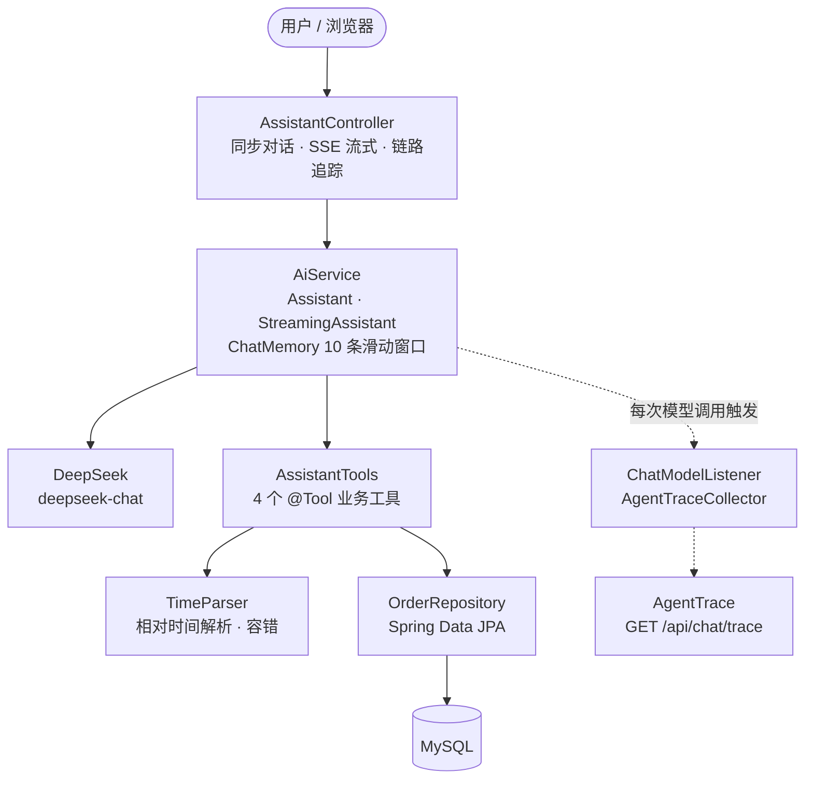
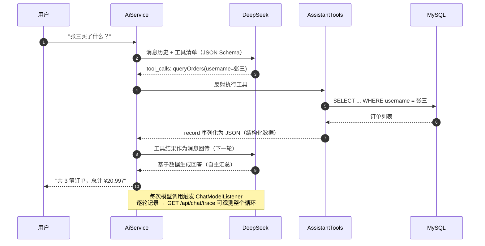

# 智能订单助手 AI Agent

基于 **LangChain4j + DeepSeek + Spring Boot 3** 的电商订单场景对话 Agent。用户用自然语言提问，模型自主决策调用后端 Java 工具查询真实数据库，支持 SSE 流式输出与**执行链路追踪**——把 Agent 循环从黑盒变成可观测、可复盘的白盒。

## 核心特性

- **Function Calling 自主编排**：4 个业务工具（订单查询 / 消费统计 / 时间段查询 / 畅销排行），模型自主决策调用哪个工具、如何填参
- **执行链路追踪**：`/api/chat/trace` 完整暴露 Agent 循环——每轮模型调用、工具选择、参数、结果回传、token 用量与耗时
- **工具层健壮性**：工具返回结构化数据（语言组织交给模型）、相对时间解析（"昨天"、"最近一周"）、参数异常引导模型自愈重试
- **SSE 流式输出**：逐 token 推送，打字机效果；多轮会话记忆（10 条消息滑动窗口）
- **可观测性**：Micrometer 指标 + OpenTelemetry 链路追踪 + 模型请求/响应全量日志
- **一键部署**：Docker Compose 编排 MySQL + 应用

## 架构



### Function Calling 一次完整循环



## 工具清单

| 工具 | 入参 | 返回（结构化 DTO） | 数据来源 |
|------|------|------|------|
| `queryOrders` | 用户名 | `List<OrderSummary>` | JPA 方法命名查询 |
| `queryTotalSpent` | 用户名 | `TotalSpent`（总金额 + 订单数） | JPQL `SUM` + 派生 `COUNT` |
| `queryOrdersByDate` | 用户名 + 时间区间（支持"昨天 / 最近一周"等相对表达） | `OrdersByDateResult`（orders + 自愈 error 通道） | Between 查询 + TimeParser |
| `bestSellingProduct` | — | `BestSellingProduct` | 原生 SQL `GROUP BY` |

## 设计决策 FAQ

**为什么工具返回结构化数据，而不是拼好的中文句子？**
工具是给模型的数据 API，不是给用户的客服话术。工具方法返回 record，框架经 Jackson 序列化为 JSON 回传模型，由模型基于原始数据组织语言。同一份数据支撑无限种问法，模型还能做二次推理——实测中模型把 3 笔订单自主汇总为表格并计算出总计 ¥20,997，而工具并未提供"总计"字段。

**模型传"昨天"这种参数怎么办？**
两层防御：第一层在 `@Tool`/`@P` 描述中声明支持的参数形式（工具描述本质是模型能看到的接口文档，从源头降低出错率）；第二层是运行时兜底——`TimeParser` 解析失败时不抛异常中断会话，而是把"怎么改"的引导说明作为结构化 `error` 回传给模型，模型读到后自行修正参数重新调用（自愈闭环）。

**为什么要做执行链路追踪？**
Agent 循环对开发者是黑盒：几轮往返、选了什么工具、参数是否正确、每步多慢。`ChatModelListener` 在每次模型调用时触发，工具结果以 `ToolExecutionResultMessage` 出现在下一轮请求消息中，逐轮记录即可重建完整决策链路。它同时是性能仪表盘——实测一次两轮对话：模型推理 2230ms，工具执行 + 框架开销仅约 31ms（≈1.4%），瓶颈在模型轮次而非数据库。

**为什么会话记忆是 10 条消息？**
每轮对话都要把历史全量发给模型，窗口大小直接决定 token 成本与延迟。滑动窗口淘汰最老消息（trace 中可肉眼观察滑动过程）。防死循环由框架兜底：LangChain4j 默认最多 100 轮工具调用往返（`maxToolCallingRoundTrips`）。

**LLM 生成的参数不可靠，还有什么兜底？**
见上一条与工具清单中的 `OrdersByDateResult`：开始时间晚于结束时间也会触发结构化 error 回传，引导模型调换后重试。

## 真实执行轨迹（采集自实测运行）

```json
{
  "question": "张三买了什么？",
  "totalRounds": 2,
  "totalDurationMs": 2261,
  "totalInputTokens": 1913,
  "rounds": [
    {
      "round": 1, "durationMs": 1300, "inputTokens": 926, "outputTokens": 45,
      "modelText": "我来帮你查一下张三的订单信息～",
      "toolCalls": [{ "name": "queryOrders", "arguments": "{\"username\": \"张三\"}" }]
    },
    {
      "round": 2, "durationMs": 930, "inputTokens": 987, "outputTokens": 130,
      "requestMessages": [
        "SYSTEM: 你是一个电商平台的智能客服助手……",
        "……（10 条滑动窗口内的历史消息）……",
        "AI→tool_calls: queryOrders({\"username\": \"张三\"})",
        "TOOL_RESULT[queryOrders]: [{\"product\":\"iPhone 15\",\"amount\":6999.00,...}]"
      ],
      "modelText": "共 3 笔订单……总计消费 ¥20,997.00"
    }
  ]
}
```

第 2 轮请求消息中出现的 `TOOL_RESULT` 行，就是"工具结果在下一轮请求中回传给模型"的直接证据；总计 ¥20,997 由模型基于 JSON 数据自主计算。

## 快速启动

### 方式一：Docker Compose 一键启动（推荐）

```bash
# 1. 配置环境变量
cp .env.example .env
# 编辑 .env，填入你的 DeepSeek API Key

# 2. 一键启动
docker-compose up -d

# 3. 访问应用
# 聊天页面: http://localhost:8082
# Swagger 文档: http://localhost:8082/swagger-ui.html
```

### 方式二：本地启动

```bash
# 前置条件：本地已安装 MySQL 8.x 和 Java 17

# 1. 创建数据库
mysql -u root -p -e "CREATE DATABASE agent;"

# 2. 配置环境变量
export DEEPSEEK_API_KEY=your_api_key_here

# 3. 编译启动
./mvnw spring-boot:run
```

### 体验链路追踪

应用启动后打开 Swagger（`http://localhost:8082/swagger-ui.html`）→ 「AI 对话」→ `GET /api/chat/trace` → Try it out → Execute，即可看到完整决策轨迹 JSON。

## API 接口

| 方法 | 路径 | 说明 |
|------|------|------|
| GET | `/api/chat?message=你好` | 同步对话 |
| POST | `/api/chat` | 同步对话（JSON Body + 参数校验） |
| GET | `/api/chat/stream?message=你好` | 流式对话（SSE） |
| GET | `/api/chat/trace?message=...` | **对话 + 执行链路轨迹** |
| GET | `/model?message=Hello` | 直接调用 ChatModel（无记忆） |
| GET | `/api/orders` | 查询所有订单 |
| GET | `/api/orders/{id}` | 按 ID 查询订单 |
| GET | `/api/orders/user/{username}` | 按用户名查询订单 |
| POST | `/api/orders` | 创建订单 |
| DELETE | `/api/orders/{id}` | 删除订单 |

## 项目结构

```
src/main/java/com/ai/assistant/
├── Application.java                  # 启动类
├── common/
│   ├── Result / BusinessException / GlobalExceptionHandler
│   └── TimeParser.java               # 相对时间解析（昨天 / 最近N天）与容错
├── config/
│   ├── AssistantConfiguration.java   # ChatMemory、ChatModelListener
│   └── OpenApiConfig.java            # Swagger 文档配置
├── controller/
│   ├── AssistantController.java      # AI 对话接口（同步 / 流式 / 链路追踪）
│   ├── ChatModelController.java      # 低层 ChatModel 接口
│   └── OrderController.java          # 订单 CRUD 接口
├── dto/
│   ├── ChatRequest / OrderRequest    # 请求 DTO
│   ├── OrderSummary / TotalSpent / BestSellingProduct   # 工具返回的结构化数据
│   ├── OrdersByDateResult            # 时间段查询结果（含自愈 error 通道）
│   └── AgentTrace / TraceRound / ToolCallRecord          # 执行链路轨迹
├── listener/
│   ├── ChatModelListenerImpl.java    # 每轮模型调用触发，喂给采集器
│   └── AgentTraceCollector.java      # ThreadLocal 逐轮采集，重建决策链路
├── model/
│   └── Order.java                    # 订单实体
├── repository/
│   └── OrderRepository.java          # 数据访问层
└── service/
    ├── Assistant.java                # 同步 AiService 接口
    ├── StreamingAssistant.java       # 流式 AiService 接口
    ├── AssistantTools.java           # AI 工具集（Function Calling）
    └── TraceChatService.java         # 链路追踪编排
```

## 测试

21 个单元测试，全部不依赖数据库与 LLM，可离线运行：

```bash
./mvnw test -Dtest="AssistantToolsTest,TimeParserTest,AgentTraceCollectorTest,TraceChatServiceTest"
```

| 测试类 | 数量 | 覆盖 |
|------|------|------|
| `AssistantToolsTest` | 10 | 工具层行为、结构化返回、容错与自愈路径 |
| `TimeParserTest` | 6 | 相对时间解析边界语义 |
| `AgentTraceCollectorTest` | 3 | 两轮轨迹重建、消息预览截断、上下文清理 |
| `TraceChatServiceTest` | 2 | 编排逻辑、异常路径的 ThreadLocal 清理 |

## 已知限制与 TODO

- **会话记忆为全局共享单窗口**：当前所有会话共用一个 `ChatMemory`，多用户并发会互相污染上下文。正解是接口增加 `@MemoryId` + `ChatMemoryProvider` 按会话隔离（见 `AssistantConfiguration` 注释）
- **流式链路的追踪未覆盖**：SSE 跑在 Reactor 线程上，ThreadLocal 不可见，`/api/chat/trace` 目前覆盖同步链路（扩展点）
- **CI 未配置**：单元测试不依赖外部环境，适合接入 GitHub Actions

## 技术栈

| 层次 | 技术 | 说明 |
|------|------|------|
| 语言 | Java 17 | LTS 版本，工具返回值使用 record |
| 框架 | Spring Boot 3.4 | 自动配置、IoC/AOP |
| Web | Spring MVC + WebFlux | 同步接口 + 响应式流式接口 |
| AI 框架 | LangChain4j 1.17 | AiService、Function Calling、ChatMemory、ChatModelListener |
| LLM | DeepSeek | OpenAI 兼容 API（更换供应商只需改 base-url 与 model-name） |
| ORM | Spring Data JPA | Repository 模式、方法命名查询、JPQL、原生 SQL |
| 数据库 | MySQL 8.0 | InnoDB 引擎 |
| 参数校验 | Hibernate Validator | JSR-380 规范 |
| API 文档 | springdoc-openapi | OpenAPI 3 规范 |
| 可观测性 | Micrometer + OpenTelemetry | 指标 + 链路追踪 (Zipkin) |
| 构建 | Maven | 依赖管理、打包 |
| 部署 | Docker + Docker Compose | 容器化、多服务编排 |
